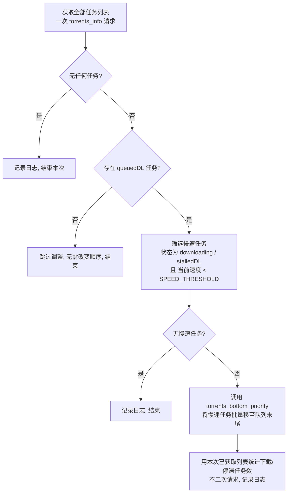

## 功能简介
- 每隔 `CHECK_INTERVAL` 秒检查 qBittorrent 中每个正在下载（downloading/stalledDL）任务的速度。
- **即时慢速移动**：每次扫描时，凡是当前下载速度低于 `SPEED_THRESHOLD` 的任务，立即移至队列末尾等待。
- 仅当存在 queuedDL（排队等待）任务时才执行调整。
- 支持 docker compose 部署
- qBittorrent（需启用 WebUI API Key 认证，≥5.2.0）
- 认证方式：**WebUI API Key**（不再使用用户名/密码）

## 运行逻辑

### 启动流程
1. 加载 `.env`，初始化日志（控制台 + 轮转文件 `/app/logs/app.log`）。
2. 校验 `QB_API_KEY` 已配置（未配置直接报错退出）。
3. 创建一次 qBittorrent Client（API Key 认证），**复用**于整个生命周期，不在每次扫描重建连接。
4. 启动时发起**一次** `app.version` 探活确认连通性（失败仅告警，不阻断，后续扫描重试）。
5. 立即执行一次扫描，随后进入定时循环。

### 单次扫描（scan_and_adjust）
每 `CHECK_INTERVAL` 秒触发一次，流程如下：



### 判定与移动规则
- **处理范围**：仅 `downloading` 或 `stalledDL` 状态的任务。
- **慢速判定**：`dlspeed < SPEED_THRESHOLD`（严格小于）。`SPEED_THRESHOLD=0` 时只移动完全无速度（0 字节/秒）的任务。
- **前置条件**：仅当列表中存在 `queuedDL`（排队等待）任务时才移动——没有排队任务就无需调整顺序（避免无谓抖动）。
- **移动动作**：批量调用 `torrents_bottom_priority`，把命中的慢速任务**一次性**移到队列末尾，让排队中的任务获得带宽。

### 定时循环
- 主循环使用 `time.sleep(CHECK_INTERVAL)` 轮询，不引入额外调度库。
- 每轮复用同一 Client；若某次获取任务失败（网络 / 鉴权），记录错误并跳过本轮，下轮继续重试，服务不退出。

## 版本与发布
版本唯一来源为 `qbslowqueue/__init__.py`，包含四个字段：
`__version__` / `__release_status__` / `__test_sequence__` / `__docker_tag__`。
Docker 镜像 tag、Compose 镜像名均由它派生，禁止在别处另设版本号。

当前为 **正式版 V1.3.0**（formal），`__test_sequence__` 归 0，镜像 tag 为干净标签 `:latest`（无 `-test.N` 标识）。
镜像地址：`docker.cnb.cool/1983shake/qb-slow-queue:latest`（由 `__init__.py` 派生）。

> 每次变更（含测试版迭代、测试版转正式版的过程总结）记录在 [`CHANGELOG.md`](CHANGELOG.md)。

## 部署步骤
1. 在 qBittorrent **WebUI → 选项 → WebUI → 认证** 中生成 API Key（格式 `qbt_` 开头，共 32 字符）。
2. 拷贝 `docker-compose.yml`，下载 `sample.env` 并重命名为 `.env`，填入 `QB_HOST` / `QB_PORT` / `QB_API_KEY`。
3. 构建并启动（镜像 tag 自动从 `__init__.py` 派生）：
   - Linux / macOS：`bash build.sh`
   - Windows（PowerShell）：`pwsh build.ps1`
4. 查看日志：`docker logs qb-slow-queue`。

> 构建时 `Dockerfile` 采用**容错源链**拉取依赖：先走原链接 `pypi.org`，失败自动退回腾讯云、清华、阿里云 PyPI 镜像，任一成功即停。若所用构建网络对四者均不可达（真·无外网），需离线安装：在有网机器 `pip download -d wheels -r requirements.txt`，把 `wheels/` 拷入镜像后 `pip install --no-index --find-links=/wheels -r requirements.txt`。

## .env 配置项
| 配置项 | 说明 | 默认值 |
|---|---|---|
| QB_HOST | qBittorrent 的 IP 地址 | 192.168.1.100 |
| QB_PORT | WebUI 端口 | 8080 |
| QB_API_KEY | WebUI API Key（**必填**） | - |
| SPEED_THRESHOLD | 速度阈值（字节/秒），0 表示仅移动无速度任务 | 51200 |
| CHECK_INTERVAL | 检查间隔（秒）；每次扫描即时移动低于阈值的任务 | 300 |
| LOG_LEVEL | 日志级别: DEBUG/INFO/WARNING/ERROR | INFO |

## 交付前校验
```bash
python verify_release.py
```
校验 `__init__.py` ↔ `Dockerfile` ↔ `docker-compose.yml` 的版本一致性。
